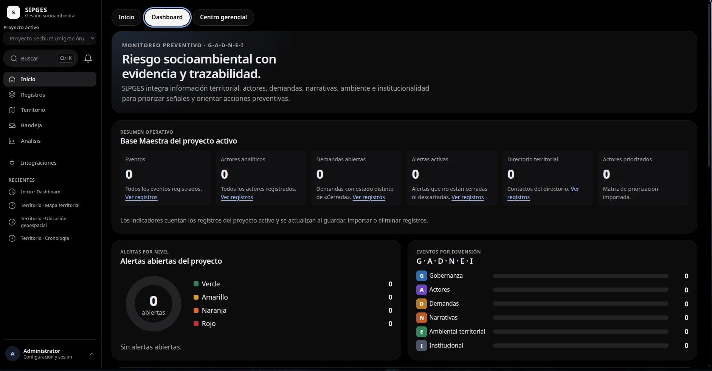
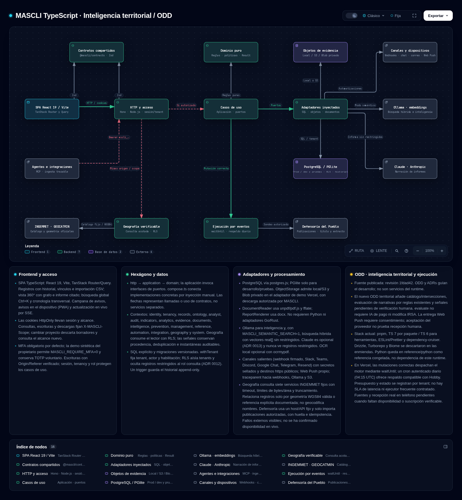

# SIPGES — Sistema Inteligente de Predicción y GEStión Social

Gestión y análisis territorial con TypeScript, Go, Rust y arquitectura hexagonal.

SIPGES es un monorepo (API Hono, SPA React/Vite, contratos Zod compartidos) sobre PostgreSQL con aislamiento por proyecto. Reúne registros territoriales, mapas, inteligencia de redes, IRSA y automatizaciones en una sola aplicación. La versión publicada es **v1.1.0** ([CHANGELOG](CHANGELOG.md)).



## Inicio rápido

Requiere Node.js 22 o posterior (la CI usa 22) y pnpm, en la versión fijada en `packageManager` de `package.json`.

```bash
pnpm install --frozen-lockfile
pnpm check                          # lint, límites de capas, tipos y pruebas
pnpm --filter @sipges/api dev       # API en http://127.0.0.1:8000
pnpm --filter @sipges/web dev       # SPA en http://127.0.0.1:5173
```

Antes de arrancar la API configura `SIPGES_DATA_KEY` y `SIPGES_ADMIN_PASSWORD`; para HTTP local, `SIPGES_COOKIE_SECURE=0`.

**[Docs →](docs/overview.md)**

## Arquitectura

[](docs/diagrams/arquitectura.html)

SPA, contratos compartidos, Hono, casos de uso, dominio, adaptadores, PostgreSQL, objetos y embeddings, con dependencias que apuntan hacia dentro. El [mapa interactivo](docs/diagrams/arquitectura.html) se descarga y se abre en el navegador.

**[Docs →](docs/ARQUITECTURA.md)**

## Stack y estado

React 19 y Vite en el frontend; Node.js, Hono y postgres.js en el backend actual; un backend Go en `apps/api-go` y motores Rust compilados a WebAssembly en `engines/` ([ADR 0032](docs/adr/0032-go-backend-rust-engines.md)); PGlite para desarrollo y pruebas. Catorce módulos de registros, dashboard, centro gerencial, mapa territorial, IRSA, validación e integración están implementados.

**[Docs →](docs/overview.md)**

## Seguridad y datos

MFA, entrada con Google para cuentas invitadas, aislamiento por proyecto con RLS y marcas de clasificación. Solo se usan datos reales del proyecto; las pruebas, fixtures y benchmarks usan datos sintéticos.

**[Docs →](docs/adr/README.md)**

## Pruebas y verificación

`pnpm verify` ejecuta el gate local completo; las comprobaciones focalizadas no lo sustituyen.

**[Docs →](docs/testing.md)**

## Despliegue

Guía de preparación para publicar la API con la SPA, y adaptador de Cloudflare Workers.

**[Docs →](docs/deployment/readiness.md)**

## Cómo se trabaja

El trabajo se planifica con ODD en [`odd/tasks`](odd/tasks) y las decisiones en los ADRs. Las guías de agentes (skills, Gentle AI y Engram) están en [AGENTS.md](AGENTS.md); para contribuir, [CONTRIBUTING.md](CONTRIBUTING.md).

**[Docs →](docs/agents/gentle-ai.md)**

## Documentación

Índice completo por tema en [docs/README.md](docs/README.md). El prototipo Python congelado está en [`reference/python`](reference/python/README.md) y su historial resumido en [docs/history/python-prototype.md](docs/history/python-prototype.md).
